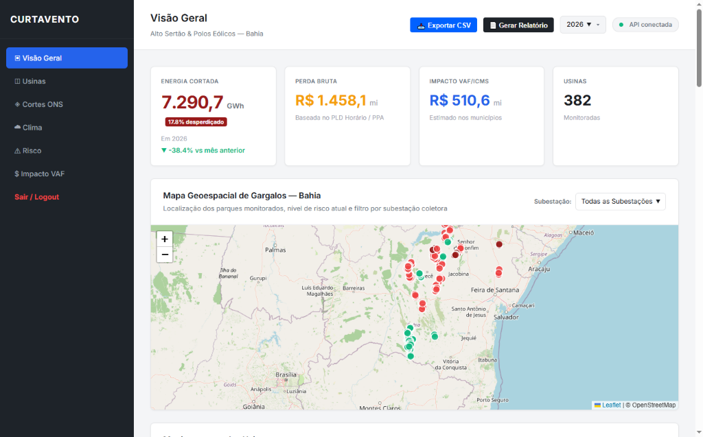
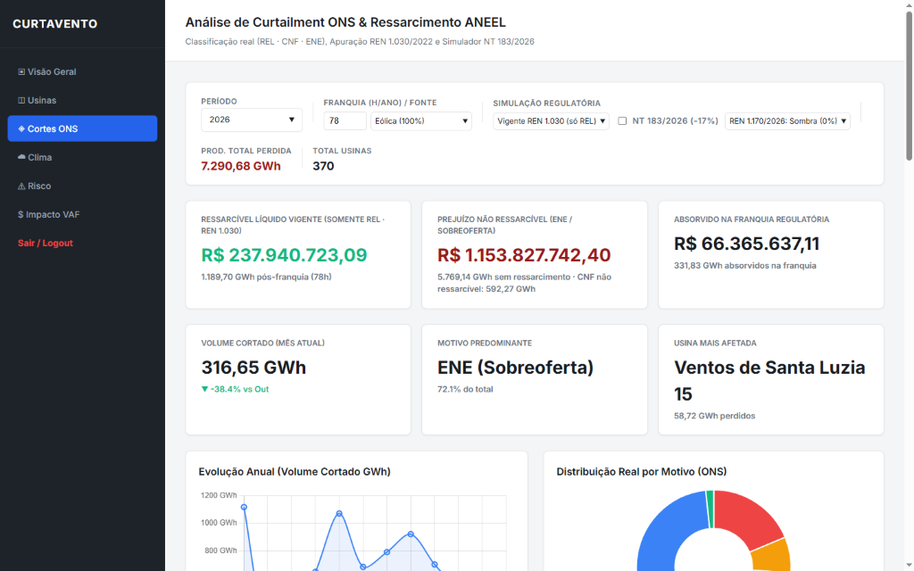
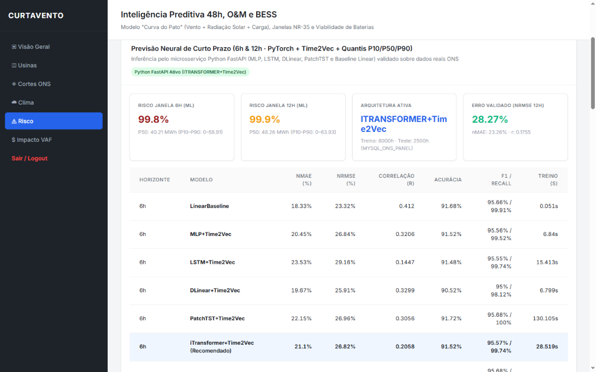
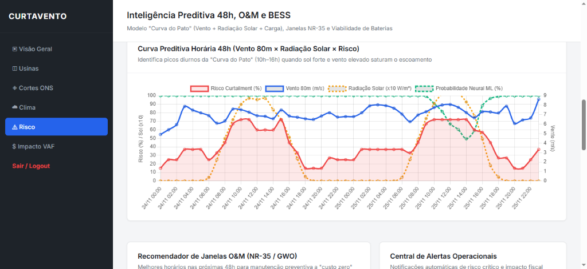
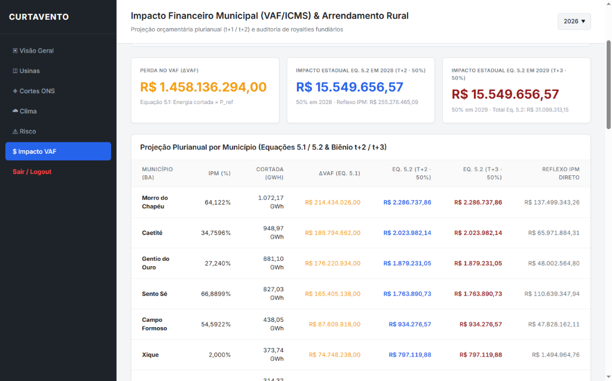

# CurtaVento — Sistema de Inteligência & Monitoramento de Curtailment Eólico

Plataforma analítica e operacional projetada para o monitoramento, previsão de risco via Machine Learning, auditoria regulatória e avaliação de impactos socioeconômicos e fiscais decorrentes do *curtailment* (cortes de geração e restrições operacionais) em parques eólicos na Bahia, com foco na microrregião do Alto Sertão Produtivo (polo de Guanambi).

---

## Visão Geral

O **CurtaVento** integra dados meteorológicos em tempo real e de reanálise atmosférica com as bases públicas do **ONS (Operador Nacional do Sistema Elétrico)** e os dados de liquidação da **CCEE (PLD - Preço de Liquidação das Diferenças)**.

A plataforma permite que operadores de parques eólicos, comercializadoras de energia e administrações municipais avaliem perdas financeiras, elegibilidade a ressarcimento regulatório, previsibilidade de restrições na rede com redes neurais artificiais, viabilidade de armazenamento em baterias (BESS) e reflexos fiscais na arrecadação municipal do Valor Adicionado Fiscal (VAF) e ICMS.

---

## Fundamentação Científica & Pré-TCC

O sistema foi concebido e expandido a partir da pesquisa acadêmica de Pré-TCC:

* **Título:** *CURTAVENTO: PLATAFORMA DE PREVISÃO DE RISCO DE CURTAILMENT EÓLICO E SEU IMPACTO SOCIOECONÔMICO MUNICIPAL NO ALTO SERTÃO (GUANAMBI/BA)*
* **Autor:** Hiago Rocha Souza
* **Instituição:** Instituto Federal de Educação, Ciência e Tecnologia Baiano (IF Baiano) — Campus Guanambi
* **Curso:** Análise e Desenvolvimento de Sistemas (ADS)

### Modelagem Fiscal e Regulatória Validada

1. **Impacto no Valor Adicionado Fiscal (Equação 5.1):**

   > **ΔVAF<sub>m</sub> = ΔE<sub>cortada,m</sub> &times; P<sub>ref</sub>**

   Onde a perda de VAF municipal (**ΔVAF<sub>m</sub>**) resulta do produto da energia cortada pela usina no município pelo preço de referência da energia (**P<sub>ref</sub>** em R$/MWh).

2. **Perda Arrecadatória Municipal de ICMS (Equação 5.2):**

   > **ΔICMS<sub>m</sub> = (ΔVAF<sub>m</sub> / VAF<sub>total,BA</sub>) &times; (ICMS<sub>total,BA</sub> &times; 0,25 &times; 0,65)**

   Onde 25% da arrecadação estadual de ICMS é constitucionalmente repassada aos municípios (CF/88 e LC nº 63/1990) e a Lei Complementar Estadual da Bahia nº 53/2022 fixa a cota do VAF em 65% do Índice de Participação dos Municípios (IPM).

3. **Defasagem Bienal na Arrecadação:**
   De acordo com a LC nº 63/1990, o VAF gerado no ano *t* compõe o índice de rateio com reflexos orçamentários distribuídos nos exercícios *t+2* (50%) e *t+3* (50%).

4. **Marco Regulatório ANEEL & ONS:**
   * **REN ANEEL nº 1.030/2022 & Submódulo 6.5 (Rev. 2025.06):** Apuração em blocos semi-horários (30 min) para indisponibilidade externa (`REL`), confiabilidade elétrica (`CNF`) e razão energética (`ENE`), com separação entre a **regra vigente** (apenas `REL` ressarcível) e a **proposta do setor/Senado** (`REL + CNF`), exclusão de cortes por Parecer de Acesso (`PAR`), fórmula oficial de franquia via `DISPF_m` e fator de 50% para solar UFV (janela diurna `04h–20h`).
   * **Rotina Operacional ONS RO-AO.BR.13:** Validação de telemetria de vento (`[0, 25] m/s`), priorização determinística em colisões (`ENE > CNF > REL > PAR`) e sincronização retroativa para revisões `D+3`, `M+8` e janela de 90 dias com checkpoint persistido em banco.
   * **Nota Técnica ONS/ANEEL nº 183/2026:** Reclassificação conservadora estimada de até 17% de elegíveis para `ENE`.
   * **Resolução Normativa ANEEL nº 1.170/2026:** Compartilhamento gradual do corte energético (`ENE`) com o encargo de Eventos de Transição (EVT) das hidrelétricas, parametrizado em 0%, 25%, 50%, 75% e 100%.

---

## Interfaces do Sistema

### 1. Dashboard Executivo & Mapa GIS de Gargalos (Bahia)


### 2. Auditoria Regulatória ONS, Franquia `DISPF_m` e Patamares (`REN 1.030/2022`, `NT 183` & `REN 1.170`)


### 3. Benchmark Neural (`iTransformer+Time2Vec`, `PatchTST`, `DLinear`, `LSTM`) e Quantis `P10/P50/P90`


### 4. Curva Preditiva Horária 48h ("Curva do Pato") & Probabilidade Neural


### 5. Impacto Financeiro Municipal (VAF / ICMS) e Defasagem Bienal (`t+2` / `t+3`)


---

## Principais Funcionalidades

* **Dashboard Executivo & Mapa GIS:** Indicadores consolidados de energia cortada, perda bruta, impacto VAF/ICMS, taxa de desperdício, filtro por subestação coletora e mapa geoespacial interativo (Leaflet) dos parques eólicos da Bahia.
* **Previsão de Risco Neural com Incerteza (`P10/P50/P90`):** Microsserviço em Python/PyTorch com codificação temporal contínua `Time2Vec` e cabeças quantílicas monotônicas aplicadas a 5 redes neurais (**`iTransformer + Time2Vec`**, **`PatchTST + Time2Vec`**, **`DLinear + Time2Vec`**, **`LSTM + Time2Vec`** e **`MLP + Time2Vec`**) além de `LinearBaseline`, treinadas em painel multi-usina `(usina_id, hora)` sobre dados reais do ONS.
* **Benchmark Automatizado de ML:** Comparativo completo nos horizontes de 6h e 12h com `nMAE`, `nRMSE`, correlação de Pearson (*r*), Acurácia, Precisão, Recall, Especificidade, F1-Score, Matriz de Confusão, Pinball Loss (`P10/P50/P90`) e tempo de treino.
* **Reanálise Climática NASA POWER & Open-Meteo:** Ingestão horária histórica e previsão 48h com cisalhamento vertical de vento a 80m via *Power Law Wind Shear* (*v(z) = v(z<sub>0</sub>) &middot; (z / z<sub>0</sub>)<sup>&alpha;</sup>*).
* **Segurança O&M em Altura (NR-35 / GWO):** Recomendação de janelas de manutenção preventiva a "custo zero" durante eventos de corte de alta probabilidade e vento seguro.
* **Auditoria Regulatória ANEEL & Diagnóstico de Patamares (`P1–P4`):** Comparador entre regra vigente (`somente REL`) e proposta setorial (`REL + CNF`), desconto `NT 183/2026`, rateio `REN 1.170/2026`, franquia solar (50%) e distribuição horária (`P1` Madrugada, `P2` Transição, `P3` Diurno Solar/MMGD, `P4` Ponta/Noturno).
* **Simulador BESS v3 (EPE `NT-086/2025` & ONS `NT-DPL 0095/2026`):** Simulação cronológica em 30 minutos (`SoC` 5%–95%, eficiências de carga/descarga separadas, degradação, VPL em 10 anos, PLD horário real), catálogo de margem remanescente por subestação da Bahia e empilhamento de receita fixa de capacidade (`LRCAP / CRCAP`).
* **Simulador de Carga Flexível / Data Center Co-locado (*Behind-the-Meter*):** Cálculo de `CEU` (*Curtailment Energy Usage*), `GEC` (*Gray Electricity Consumption*), economia de TUST e garantia `GPA` (`3 × MUST × TUST`, REN 1.122/2025), buffer de adiamento temporal (*Backlog* `H_makeup`), roteamento espacial entre duas usinas (*Geo-Shifting*) e emissões evitadas (tCO2e).
* **Impacto Fiscal Municipal (VAF) & Arrendamento Rural:** Projeção bienal (`t+2` / `t+3`) alinhada à FGV (2024) e SDE-BA (2026), utilizando o IPM municipal oficial e auditoria de royalties fundiários rurais.
* **Sincronização & Backfill ONS (Eólica + Solar UFV):** Ingestão automática em lote e job diário com checkpoint persistido em banco (`ons_sync_checkpoint`).

---

## Arquitetura de Software

A plataforma é composta por um backend modular em **Spring Boot (Java 21)** seguindo **Clean Architecture / Arquitetura Hexagonal**, integrado a um microsserviço de inteligência artificial em **FastAPI (Python 3.11+)**:

```
curta-vento/
├── src/main/java/com/curtavento/curta_vento/
│   ├── domain/                    # Entidades de domínio, enums e portas (interfaces)
│   ├── application/               # Casos de uso (BESS v3, Data Center v2, ANEEL, VAF, Risco 48h)
│   ├── config/                    # Configurações de segurança, Flyway e MVC
│   ├── infrastructure/            # Adaptadores de saída, persistência e integrações
│   │   ├── batch/                 # SincronizacaoOnsJob com checkpoint persistido
│   │   ├── client/                # Clientes HTTP (Open-Meteo, NASA POWER, MlPrevisaoClient)
│   │   ├── ons/                   # Parsers e backfill eólico/solar do ONS (RO-AO.BR.13)
│   │   ├── persistence/           # Entidades JPA, Repositories e Migrações Flyway
│   │   └── security/              # Autenticação stateless JWT e filtros
│   └── interfaces/                # Adaptadores de entrada (REST Controllers e DTOs)
│
├── ml-service/                    # Microsserviço de Machine Learning (Python/PyTorch)
│   ├── app/
│   │   ├── features/              # Time2Vec contínuo multiescala
│   │   ├── models/                # iTransformer, PatchTST, DLinear, LSTM, MLP + quantis P10/P50/P90
│   │   ├── evaluation/            # nMAE, nRMSE, Pearson r, F1/Recall/Spec, matriz e Pinball Loss
│   │   ├── training/              # Pipeline multi-usina (MYSQL_ONS_PANEL) + Ridge/Logistic baseline
│   │   └── main.py                # Endpoints FastAPI (/health, /models/benchmark, /models/train, /predict/curtailment)
│   ├── artifacts/                 # Relatório benchmark_report.json e checkpoints locais (.pt ignorados)
│   └── tests/                     # Testes automatizados com pytest
│
└── src/main/resources/static/     # Frontend SPA responsivo (HTML5, CSS3, JS ES6+, Chart.js, Leaflet)
```

---

## Tecnologias Utilizadas

### Backend Principal (Java)
* **Linguagem:** Java 21 LTS
* **Framework:** Spring Boot 4.x
* **Persistência:** Spring Data JPA com batching JDBC e Hibernate
* **Migrações:** Flyway
* **Segurança:** Spring Security com autenticação JWT stateless
* **Banco de Dados:** MySQL 8.x

### Microsserviço de Inteligência Artificial (Python)
* **Linguagem:** Python 3.11+
* **Framework Web:** FastAPI e Uvicorn
* **Deep Learning:** PyTorch (CPU)
* **Processamento de Dados:** Pandas, NumPy e Scikit-Learn
* **Testes:** Pytest

### Frontend & Integrações
* **Frontend:** HTML5 semântico, CSS3 responsivo (desktop, tablet e mobile), JavaScript ES6+, Chart.js e Leaflet.js
* **Fontes de Dados:** ONS Open Data (eólica + solar), CCEE (PLD horário), Open-Meteo e NASA POWER

---

## Modelos de Machine Learning & Métricas

O microsserviço de ML implementa embeddings temporais contínuos baseados em Kazemi et al. (2019) (*Time2Vec*) com inicialização multiescala e regressão quantílica monotônica (`P10/P50/P90`) treinada com *Pinball Loss* + *BCE* + *MSE* em painel multi-usina (`MYSQL_ONS_PANEL`, 8.000 janelas de treino / 2.500 de teste).

### Arquiteturas Avaliadas
1. **iTransformer + Time2Vec *(Recomendado no benchmark atual)*:** Atenção invertida entre *tokens* de variáveis físicas e temporais (Liu et al., ICLR 2024), capturando acoplamentos multivariados com menor `nRMSE` de 12h e menor `Pinball Loss`.
2. **PatchTST + Time2Vec:** Transformer independente por canal sobre *patches* temporais com `RevIN` (Nie et al., ICLR 2023).
3. **DLinear + Time2Vec:** Decomposição em média móvel (tendência + sazonalidade) com projeção linear direta (Zeng et al., AAAI 2023).
4. **LSTM + Time2Vec:** Rede recorrente de 2 camadas para dependências temporais sequenciais.
5. **MLP + Time2Vec:** Rede densa feedforward com normalização em camada e ativação GELU.
6. **LinearBaseline:** Referência clássica com `Ridge` + `LogisticRegression`.

### Métricas de Validação (Horizontes de 6h e 12h)
* **nMAE / nRMSE (%):** Erros normalizados pela capacidade de referência da usina.
* **Pinball Loss (MWh):** Acurácia probabilística dos quantis `P10`, `P50` e `P90`.
* **Correlação de Pearson (*r*):** Aderência temporal entre a série real e a predita.
* **Classificação Binária:** Acurácia, Precisão, Recall, Especificidade, F1-Score e Matriz de Confusão (`VP`, `VN`, `FP`, `FN`).

---

## Endpoints da API REST

### Backend Spring Boot (`http://localhost:8080`)

| Módulo | Método | Rota | Descrição |
| :--- | :---: | :--- | :--- |
| **Auth** | `POST` | `/api/auth/login` | Autenticação e emissão de token JWT |
| **Usuários** | `POST` | `/api/usuarios` | Cadastro de novos usuários |
| **Dashboard** | `GET` | `/api/dashboard/resumo-geral` | Métricas globais consolidadas, mapa e filtros |
| **Usinas** | `GET` / `POST` | `/api/usinas` | Listagem e cadastro de usinas |
| **Cortes ONS** | `GET` | `/api/cortes-ons/usina/{usinaId}` | Histórico detalhado de cortes da usina |
| **Cortes ONS** | `GET` | `/api/cortes-ons/ranking` | Ranking das usinas com maiores perdas de geração |
| **Cortes ONS** | `GET` | `/api/cortes-ons/motivos` | Agrupamento por motivos (`REL`, `CNF`, `ENE`, `PAR` excluído) |
| **Cortes ONS** | `GET` | `/api/cortes-ons/patamares` | Distribuição horária nos patamares `P1–P4` (ONS RT 0189/2025) |
| **Cortes ONS** | `GET` | `/api/cortes-ons/evolucao` | Série temporal mensal de cortes no ano |
| **Cortes ONS** | `GET` | `/api/cortes-ons/auditoria` | Últimas inserções registradas para auditoria |
| **Cortes ONS** | `GET` | `/api/cortes-ons/ressarcimento` | Apuração `REGRA_VIGENTE_REL` vs `PROPOSTA_SENADO_REL_CNF`, `DISPF_m` (Solar 50%), `NT 183` e `REN 1.170` |
| **Clima** | `GET` | `/api/clima/usinas/{id}/historico` | Dados meteorológicos históricos da usina |
| **Clima** | `GET` | `/api/clima/usinas/{id}/reanalise-nasa` | Série horária de reanálise atmosférica da NASA POWER |
| **Clima** | `GET` | `/api/clima/previsao-rajadas` | Previsão de rajadas e direção do vento |
| **Clima** | `GET` | `/api/clima/rosa-ventos` | Distribuição direcional e intensidade média do vento |
| **Previsões** | `GET` | `/api/previsoes/usina/{usinaId}` | Previsão horária de risco de curtailment |
| **Previsões** | `GET` | `/api/previsoes/curva-48h` | Curva 48h (`?usinaId=...&arquitetura=AUTO\|ITRANSFORMER\|PATCHTST\|LSTM\|DLINEAR\|MLP`) com quantis `P10–P90` e NR-35 |
| **Previsões** | `GET` | `/api/previsoes/benchmark-ml` | Relatório comparativo consolidado dos modelos de ML |
| **Simuladores** | `POST` | `/api/simuladores/bess` | Simulador BESS v3 (SoC contínuo, VPL 10a, NT-ONS 0095/2026 e LRCAP) |
| **Simuladores** | `POST` | `/api/simuladores/datacenter` | Simulador Data Center v2 (`CEU/GEC`, TUST+GPA, backlog temporal, geo-shifting e tCO2e) |
| **Impacto VAF** | `GET` | `/api/impacto-vaf` | Relatório de impacto municipal (Equações 5.1 e 5.2) |
| **Impacto VAF** | `GET` | `/api/impacto-vaf/projecao-plurianual` | Projeção bienal `t+2` (50%) e `t+3` (50%) por município |
| **Impacto VAF** | `GET` | `/api/impacto-vaf/arrendamento-rural` | Perda de receitas de royalties fundiários rurais |
| **Alertas** | `GET` | `/api/alertas` | Listagem de alertas operacionais da conta |
| **Alertas** | `PUT` | `/api/alertas/{id}/marcar-lido` | Confirmação de leitura de alertas |
| **Backfill** | `POST` | `/api/admin/backfill-ons` | Disparo de carga mensal histórica do ONS (Admin) |
| **Backfill** | `POST` | `/api/admin/backfill-ons/intervalo` | Disparo de carga por intervalo de meses (Admin) |

### Microsserviço de Machine Learning (`http://localhost:8001`)

| Método | Rota | Descrição |
| :---: | :--- | :--- |
| `GET` | `/health` | Verificação de status e saúde do serviço de ML |
| `GET` | `/models/benchmark` | Métricas comparativas (`nMAE`, `nRMSE`, `Pearson r`, `F1`, `Pinball Loss`) |
| `POST` | `/models/train` | Retreinamento em painel multi-usina sobre os blocos do MySQL |
| `POST` | `/predict/curtailment` | Inferência probabilística e quantílica (`P10/P50/P90`) para 6h e 12h |
---

## Como Executar o Projeto

### Pré-requisitos
* Java 21 JDK instalado
* Python 3.11 ou superior instalado
* MySQL 8 instalado e em execução
* Git

### 1. Clonar o Repositório
```bash
git clone https://github.com/HiagoLBP/CurtaVento.git
cd CurtaVento
```

### 2. Configurar o Banco de Dados
Certifique-se de que o MySQL possui a base de dados criada:
```sql
CREATE DATABASE curtavento CHARACTER SET utf8mb4 COLLATE utf8mb4_unicode_ci;
```

As migrações do schema e tabelas iniciais são executadas automaticamente pelo **Flyway** na inicialização do backend Java.

### 3. Executar o Microsserviço de Machine Learning (Python)
Abra um terminal na pasta `ml-service/`:
```bash
# Acessar diretório
cd ml-service

# Criar ambiente virtual
python -m venv .venv

# Ativar ambiente virtual
# Windows:
.\.venv\Scripts\activate
# Linux/macOS:
source .venv/bin/activate

# Instalar dependências
pip install -r requirements.txt

# Executar os testes automatizados
pytest -v

# Iniciar o servidor FastAPI na porta 8001
uvicorn app.main:app --host 0.0.0.0 --port 8001 --reload
```

O microsserviço estará ativo em: `http://localhost:8001`. A documentação OpenAPI interativa estará disponível em `http://localhost:8001/docs`.

### 4. Executar o Backend Principal (Java/Spring Boot)
Em outro terminal, a partir da raiz do projeto:
```bash
# Windows
.\mvnw.cmd spring-boot:run

# Linux / macOS
./mvnw spring-boot:run
```

A aplicação web e a API estarão disponíveis em: `http://localhost:8080`.

**Atalho na raiz do projeto (inicia ML Python + Spring Boot em paralelo no Windows):**
```bat
:: Prompt de Comando (cmd.exe)
start cmd /k "set PYTHONPATH=ml-service && ml-service\.venv\Scripts\python.exe -m uvicorn app.main:app --host 127.0.0.1 --port 8001" && mvnw.cmd spring-boot:run
```
```powershell
# PowerShell
Start-Process powershell -ArgumentList "-NoExit", "-Command", "`$env:PYTHONPATH='ml-service'; .\ml-service\.venv\Scripts\python.exe -m uvicorn app.main:app --host 127.0.0.1 --port 8001"; .\mvnw.cmd spring-boot:run
```

### 5. Executar os Testes Unitários e de Integração do Backend Java
```bash
# Windows
.\mvnw.cmd test

# Linux / macOS
./mvnw test
```

### 6. Executar Backfill Histórico via CLI (Opcional)
Para importar dados do ONS diretamente pela linha de comando sem abrir o servidor web:
```bash
# Windows
.\mvnw.cmd spring-boot:run "-Dspring-boot.run.arguments=--backfill=2026-01:2026-11 --spring.main.web-application-type=none"

# Linux / macOS
./mvnw spring-boot:run -Dspring-boot.run.arguments="--backfill=2026-01:2026-11 --spring.main.web-application-type=none"
```

### 7. Executar com Docker
```bash
# Construir a imagem otimizada
docker build -t curtavento-api .

# Executar o container
docker run -p 8080:8080 --name curtavento curtavento-api
```

---

## Autor

Desenvolvido por **[Hiago L. B. P.](https://github.com/HiagoLBP)** — Instituto Federal Baiano (Campus Guanambi).

---

## Licença & Propriedade Intelectual

Copyright (c) 2026 Hiago Rocha Souza. Todos os direitos reservados.

Este projeto é protegido pela legislação brasileira de direitos autorais e propriedade intelectual de programa de computador (**Lei Federal nº 9.609/1998** e **Lei Federal nº 9.610/1998**).

O código-fonte é disponibilizado publicamente em modalidade **Source-Available para fins estritamente acadêmicos, de avaliação curricular e pesquisa científica**. São expressamente proibidas a reprodução não autorizada, plágio, redistribuição ou qualquer forma de exploração comercial sem autorização prévia por escrito do autor. Consulte o arquivo [LICENSE](file:///c:/Users/Hiago/Desktop/curta-vento/LICENSE) para os termos e condições integrais.
